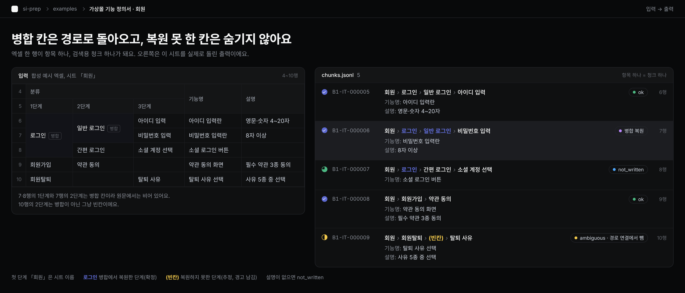
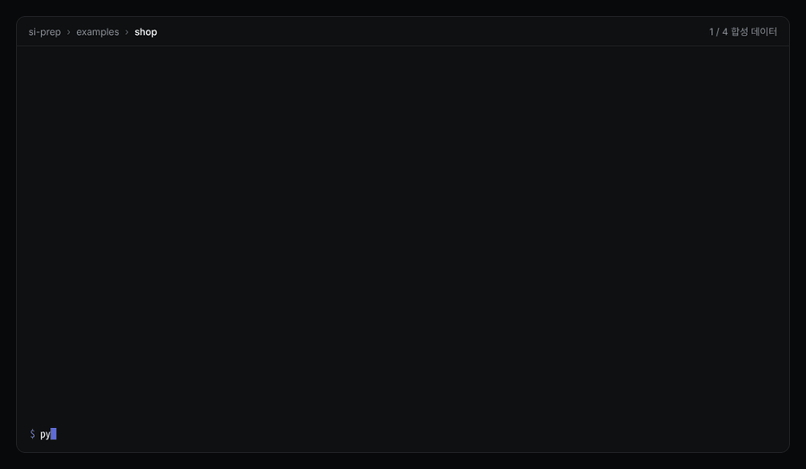

<p align="center">
  <picture>
    <source media="(prefers-color-scheme: dark)" srcset="docs/images/logo-dark.png">
    
  </picture>
</p>

<p align="center">
  
  
  
  
</p>

**SI 프로젝트 엑셀 산출물을 RAG에 넣기 좋은 데이터로 바꾸는 전처리 도구**

> **베타(v0.1.0)예요.** 합성 예시와 팀 프로젝트 문서로 검증했지만, 지원하는 양식이 아직 일부예요(10장 「한계」). 설정 형식과 출력 스키마는 0.x 동안 바뀔 수 있어요. 바뀌면 `docs/schema/CHANGELOG.md`에 적어요.



요구사항 정의서, 기능 정의서, 정책 정의서, 테스트 케이스 같은 엑셀 문서를 읽어서 이 세 가지를 만들어요.
- **항목:** 한 행을 업무 항목 하나로 정리해요.
- **연결:** 문서 사이 연결을 근거와 함께 복원해요.
- **청크:** 검색에 넣을 글을 만들어요.

모든 결과에 원문 위치(파일 · 시트 · 행)가 붙어요. 처리는 LLM 없이 코드로만 해서, 같은 입력이면 항상 같은 결과가 나와요.

```
엑셀 산출물 + 설정(YAML)  ──▶  si-prep  ──▶  items · links · chunks · warnings (JSONL) + 처리 보고서
```

---

## 1. 어떤 문제를 푸나요

SI 엑셀을 그대로 행 단위로 잘라 RAG에 넣으면 세 가지가 깨져요.

| 문제 | 예 |
|---|---|
| **병합 칸이 빈칸이 돼요** | 「주문」이 B5:B7 병합이면 6·7행은 분류 없이 「카드 결제」만 남아요 |
| **문서 사이 연결이 사라져요** | 기능 「카드 결제」와 테스트 「카드 결제 확인」이 같은 기능이라는 걸 검색이 모르게 돼요 |
| **출처를 되짚기 어려워요** | 답의 근거가 엑셀 몇 행인지 알 수 없어요 |

회사마다 양식(머리글 위치, 분류 열, 시트 구성)이 달라서, 매번 스크립트를 새로 짜거나 LLM에게 통째로 맡기게 돼요. LLM에게 맡기면 결과가 매번 다르고 행 위치가 틀릴 수 있어요.

si-prep은 **양식 정보는 설정(YAML)에 두고, 읽고 잇는 방법은 코드에 둬요.** 양식이 달라도 코드는 그대로 두고 설정만 바꿔요.

## 2. 주요 기능

- **분류 경로 복원:** 시트 이름과 분류 열로 「주문 › 결제 › 카드 결제」 같은 경로를 만들어요. 병합 칸은 복원하고, 경로 단계마다 **어디서 온 값인지(basis)**를 남겨요.
  - `sheet_name`, `cell`, `merge_restored`: 확정
  - `filled_down`(빈칸을 위 값으로 채움), `empty`: 추정
- **근거 있는 연결만:** 문서에 적힌 단서로만 이어요. 링크마다 근거 글자와 양쪽 원문 위치가 붙어요.

  | 방식 | 단서 | 등급 |
  |---|---|---|
  | `path` | 분류 경로가 같음 | 구조적 |
  | `sheet_to_path` | 시트 이름 = 상대 경로 앞부분 | 구조적 |
  | `path_prefix` | 경로 전체 = 상대 경로 앞부분 | 구조적 |
  | `glossary` | 사람이 승인한 용어 사전으로 바꿔 읽으면 같음 | 구조적 |
  | `id_ref` | 참조 칸의 ID = 상대의 자기 ID | 명시적 |

  추정 경로 항목은 경로를 쓰는 연결에서 빼요. ID 연결과 검색 청크에는 남아요.
- **멈추지 않고 경고:** 못 읽은 곳, 없는 ID 참조, 같은 ID 중복, 문서끼리 다른 설명, 지원하지 않는 표 모양을 위치와 함께 `warnings.jsonl`에 남기고 나머지는 계속 처리해요.
- **사람이 읽는 처리 보고서:** `report.md` 맨 위 「먼저 볼 것」에 할 일과 근거 숫자, 볼 곳을 모아요.
- **설정 검사:** 실행 전에 설정 오타와 실제 엑셀의 시트·머리글을 대조해요(`--excel`).
- **출력 계약:** 출력 모양은 `src/si_prep/schema.py`(pydantic) 하나로 정의하고, 검색 쪽이 이 파일을 그대로 불러 검증하도록 만들었어요.

**기술 스택:** Python 3.11+ · openpyxl(엑셀 읽기) · pydantic v2(스키마 검증) · PyYAML(설정) · pytest

## 3. 동작 흐름

```
설정 검사 (config)
   │
   ▼
엑셀 읽기 (reader)        칸 값 · 병합 범위 · 숨김 · 테두리. 형식은 확장자 + 파일 앞부분(zip/OLE)으로 판단
   ▼
표 찾기 (layout)          머리글 위치, 열 역할(분류 · ID · 제목 · 설명), 한 시트 여러 표
   ▼
항목 경계 (boundary)      몇 행이 항목 하나인지 (지금은 한 행 = 한 항목)
   ▼
분류 경로 (hierarchy)     시트 이름 + 분류 열, 병합 복원, 단계별 basis
   ▼
항목 초안 (extract)       원문 값 · 병합 값 · 제목 · 설명 · ID · 상태(ok / not_written / unparsed / ambiguous)
   ▼
IT 번호 → 연결 (link) → LK 번호 → 청크 (chunks) → 경고 정렬 · WN 번호
   ▼
쓰기 (run.write)          items · links · chunks · warnings .jsonl + report.md
```

모든 단계는 `run.build()`가 순서대로 불러요. 경고는 단계마다 `issues`에 쌓고 버리지 않아요.

### 코드 구조 (`src/si_prep/`)

| 파일 | 책임 |
|---|---|
| `config.py` | project.yaml · 프로필 · 용어집 읽기와 검사, `--excel` 대조 |
| `reader.py` | 엑셀 열기, 칸 · 병합 · 테두리 색인(시트당 한 번), 실제 데이터 범위 계산 |
| `layout.py` | 머리글 · 열 역할 · 표 범위, 표 배치 경고 |
| `boundary.py` | 항목 경계 방식 등록표 |
| `hierarchy.py` | 분류 경로 방식 등록표, 병합 복원 · 빈칸 채우기 · 테두리 묶음 |
| `extract.py` | 항목 초안, 상태, ID 추출, 칸 경고 |
| `link.py` | 연결 방식 등록표(path · sheet_to_path · path_prefix · glossary · id_ref) |
| `chunks.py` | 항목 하나 → 검색용 청크 하나 |
| `report.py` | 처리 보고서 |
| `schema.py` | 출력 모델과 공용 규칙(검색 쪽과 같이 씀) |
| `registry.py` | 「방식 이름 → 함수」 등록표. 미구현이면 그 시트 · 규칙만 건너뛰고 경고 |
| `issues.py` · `normalize.py` | 경고 모으기 · 비교용 글자 다듬기 |
| `run.py` | 실행 순서(`build`)와 저장(`write`) |
| `glossary_candidates.py` | 짝 없는 항목에서 용어 사전 초안 후보 만들기 |

새 방식을 더할 때는 함수 하나에 `@REGISTRY.register("이름")`을 붙이고 테스트를 더해요. 다른 파일은 고치지 않아요.

## 4. 설치

Python 3.11 이상이 필요해요. 외부 서비스, API 키, `.env`, DB는 필요 없어요.

```bash
git clone <이 저장소 주소>
cd si-prep
python -m venv .venv
# Windows: .venv\Scripts\activate    macOS/Linux: source .venv/bin/activate
pip install -e ".[dev]"
```

## 5. 30초 실행 (합성 예시 데이터)

저장소에는 엑셀을 넣지 않아요. 예시용 합성 엑셀(가상 쇼핑몰 문서 5종)은 아래 명령으로 만들어요.

```bash
# 1) 합성 엑셀 만들기 → tests/fixtures/generated/
python tests/fixtures/make_fixtures.py

# 2) 설정 검사 (실제 엑셀의 시트 · 머리글과 대조)
python -m si_prep.config examples/shop/project.yaml --excel

# 3) 실행 → out/shop-example/
python -m si_prep --project examples/shop/project.yaml --out out/shop-example
```



실행 화면:

```
항목 50 · 연결 19 · 경고 8 · 청크 50
경고 종류: content_mismatch 1, duplicate_id 1, link_unconfirmed 1, merge_unrestored 1, ref_unresolved 1, unparsed 1, unsupported_layout 1, version_mismatch 1

| 문서 | 파일 | 시트 | 항목 수 | 청크 수 | ...
| fo   | 가상몰_기능정의서_v1.2.xlsx | 주문 | 3 | 3 | ...
...
추정 경로라 연결에서 빠진 항목(문서별): fo 1
처리 보고서: out/shop-example/report.md
```

예시 데이터에는 일부러 넣은 문제(없는 ID 참조, 같은 ID 두 번, 요약과 상세의 설명 차이, 표지와 파일 이름의 버전 차이 등)가 있어서 경고가 나와요.

## 6. 출력 예시

**items.jsonl** (한 줄 = 항목 하나)
```json
{"item_id": "IT-000010", "doc_type": "fo", "title": "카드 결제 버튼",
 "category_path": [{"level": 1, "value": "주문", "basis": "sheet_name"},
                   {"level": 2, "value": "결제", "basis": "cell"},
                   {"level": 3, "value": "결제 수단", "basis": "cell"},
                   {"level": 4, "value": "카드 결제", "basis": "cell"}],
 "category_path_text": "주문 › 결제 › 결제 수단 › 카드 결제",
 "raw_fields": {"E": {"header": "기능명", "value": "카드 결제 버튼"}, "F": {"header": "설명", "value": "국내 카드만 지원"}, "...": "..."},
 "locations": [{"file": "가상몰_기능정의서_v1.2.xlsx", "sheet": "주문", "rows": {"start": 6, "end": 6}}],
 "status": "ok"}
```

**chunks.jsonl** (검색 DB에 넣는 글, 항목 하나 = 청크 하나)
```json
{"chunk_id": "B1-IT-000010",
 "text": "주문 › 결제 › 결제 수단 › 카드 결제\n기능명: 카드 결제 버튼\n설명: 국내 카드만 지원",
 "source": {"file": "가상몰_기능정의서_v1.2.xlsx", "sheet": "주문", "rows": {"start": 6, "end": 6}},
 "meta": {"item_id": "IT-000010", "doc_type": "fo", "category_path_text": "주문 › 결제 › 결제 수단 › 카드 결제", "...": "..."}}
```

**links.jsonl** (방향 없는 연결, 근거 · 위치 포함)
```json
{"link_id": "LK-000016", "item_a": "IT-000001", "item_b": "IT-000043",
 "grade": "explicit", "method": "id_ref", "rule_id": "test_req",
 "evidence_text": "참조 ID 일치: REQ-001 (가상몰_테스트케이스.xlsx 테스트케이스 C2 → 가상몰_요구사항정의서.xlsx 요구사항 D2)",
 "evidence_locations": [{"file": "가상몰_테스트케이스.xlsx", "sheet": "테스트케이스", "rows": {"start": 2, "end": 2}, "cols": ["C"]},
                        {"file": "가상몰_요구사항정의서.xlsx", "sheet": "요구사항", "rows": {"start": 2, "end": 2}, "cols": ["D"]}]}
```
항목 ↔ 묶음 연결은 `item_a`/`item_b` 대신 `item`/`group`(문서 종류 + 경로 앞부분)을 써요.

**warnings.jsonl**
```json
{"warning_id": "WN-000007", "kind": "ref_unresolved",
 "message": "연결 규칙 test_req: 가상몰_테스트케이스.xlsx 테스트케이스 C4의 참조 ID REQ-999를 req 문서에서 찾지 못했습니다",
 "locations": [{"file": "가상몰_테스트케이스.xlsx", "sheet": "테스트케이스", "rows": {"start": 4, "end": 4}, "cols": ["C"]}]}
```

**report.md** (일부)
```
## 0. 먼저 볼 것
- 상태: 공식 실행(모든 설정이 승인됨)
- 핵심 숫자: 항목 50 · 연결 19 · 경고 8
할 일:
- [ ] 규칙 fo_test의 짝 없는 항목 보기 — 근거: 못 찾은 16 — 볼 곳: 4절 「fo_test」
- [ ] 추정 경로 항목 보기(경로 연결에서 빠짐) — 근거: 1개 — 볼 곳: 6절
```

출력 형식 정의: `src/si_prep/schema.py`, JSON Schema: `docs/schema/`

### RAG에서 쓰는 법
- **검색 DB에는 `chunks.jsonl`만** 넣어요(`text` 임베딩 + `meta`).
- 검색된 청크의 `meta.item_id`로 `links.jsonl`에서 같이 볼 항목을 찾아요. 묶음 연결이면 `schema.group_contains`로 `items.jsonl`에서 묶음 안 항목을 골라요.
- 답변에는 청크의 `source`(파일 · 시트 · 행)를 출처로 보여 줘요.

## 7. 내 문서에 쓰기

설정은 두 층이에요.

| 파일 | 담는 것 |
|---|---|
| `project.yaml` (프로젝트당 하나) | 문서 종류와 파일 목록, 연결 규칙, 용어 사전, 문서 우선순위 |
| 프로필 (문서 종류마다 하나) | 읽을 시트, 머리글 행, 분류 · ID · 제목 · 설명 열(머리글 글자로 찾음), 항목 경계, 빈칸 처리 |

예시는 `examples/shop/`에 있어요. 처음 보는 문서를 받을 때 따르는 순서(진단 → 설정 초안 → 설정 검사 → 시험 실행 → 보고서 보고 고치기 → 사람 승인 → 공식 실행)는 [docs/intake/README.md](docs/intake/README.md)에 있어요.

```bash
python -m si_prep.config <project.yaml> --excel                      # 설정 검사
python -m si_prep --project <project.yaml> --out <결과 폴더>            # 실행
python -m si_prep.glossary_candidates --project <project.yaml> --out <결과 폴더>   # 용어 사전 초안
```

- 결과 폴더는 저장소 밖이나 저장소의 `out/` 아래만 허용해요. 결과에는 셀 내용이 들어가서 실수로 커밋되지 않게 막아요(`.gitignore`에 `out/`, `*.xlsx`, `configs/private/`가 있어요).
- 실제 프로젝트 설정은 `configs/private/<프로젝트>/`에 두면 커밋되지 않아요.
- 프로필 파일은 `project.yaml`과 같은 폴더나 그 아래에 두세요. 프로필이 `project.yaml` 폴더 밖(`../`)에 있으면 설정 검사가 멈추는 알려진 문제가 있어요.
- 종료 코드: `0` 정상(경고가 있어도 0) · `1` 설정 오류 또는 결과 폴더 위치 오류 · `2` 사용법 오류 · `3` 결과 파일 바꿔 넣기 실패(다른 프로그램이 파일을 열고 있음 등)
- Windows 콘솔에서 기호(›)가 ?로 보이면 `python -X utf8 -m si_prep ...`으로 실행해요.

## 8. 테스트와 검증

```bash
python -m pytest
```

GitHub Actions(`.github/workflows/test.yml`)가 푸시할 때마다 Ubuntu와 Windows, Python 3.11~3.14에서 같은 테스트를 돌려요.

- **결과:** 765 통과 · 2 건너뜀 (Python 3.11 · 3.12 · 3.13 · 3.14에서 확인). 건너뛰는 2개는 실제 문서의 용어가 합성 데이터에 들어가지 않았는지 보는 검사라, 진단표가 없는 공개 저장소에서는 건너뛰어요.
- **방식:** `tests/fixtures/make_fixtures.py`가 합성 엑셀을 만들고, `tests/fixtures/expected.py`의 기대값(항목 · 연결 · 경고 번호와 위치)과 실제 출력을 자동으로 비교해요.
- **오류 상황도 테스트해요.** 병합 · 빈칸 · 숨김 행과 열 · 수식 계산값 없음 · 수식 오류 · 머리글 못 찾음 · 한 시트 여러 표 · 떨어진 값 덩어리 · 차트 시트 · 옛 .xls · 이름만 .xlsx인 파일 · 없는 ID 참조 · 같은 ID 중복 · 설정 오타 · 결과 폴더 위치 오류.
- **같은 입력 같은 결과:** 같은 설정으로 두 번 실행하면 4개 결과 파일과 보고서가 바이트까지 같아요.
- **코드에 양식이 박히지 않았는지:** `test_no_hardcode.py`가 코드에 특정 시트 · 열 이름이 들어가지 않았는지 검사해요.

## 9. 평가 (품질을 판단한 기준과 사례)

> **재현 범위:** 이 절의 수치는 팀 평가 환경(검색 · 평가 코드 `rag_core`, 평가 데이터와 정답지)에서 잰 값이에요. 이 코드와 자료는 이 저장소에 없어서, **이 저장소만으로는 아래 수치를 재현할 수 없어요.** 이 저장소로 재현할 수 있는 것은 8장의 테스트와 5장의 예시 실행이에요.

검색 품질은 별도 평가 코드(팀원이 담당한 `rag_core`)로 쟀어요. 여기에는 공개 가능한 최종 평가 하나만 적어요.

**조건 (실행 전에 등록하고 한 번만 실행)**
- 데이터: 합성 SI 문서 세트 1개, 질문 30개. 정답지는 AI 초안이고 현업 검수 전이에요.
- 비교: 같은 임베딩(bge-m3, 로컬), 같은 근거 예산 4,000토큰(검색 2,000 + 연결 2,000), 같은 후보 100개, 리랭커 없음
- 채점: 질문마다 필수 근거 행의 50% 이상을 담으면 적중(회수율). LLM으로 채점하지 않아요.
- 통계: 질문 단위 쌍대 부트스트랩 10,000회, 95% 신뢰구간. 통과 기준은 하한 > 0.

**결과 (회수율, %)**

| 방식 | 회수율 |
|---|---|
| B0-R: 행 단위로 자르기 | 18.33 |
| B0-RC: 일반 재귀 분할 | 24.17 |
| B0-S: 시트 단위 | 26.39 |
| si-prep 청크, 검색만 | 34.17 |
| si-prep 청크, 검색 + 연결 따라가기 | 39.44 |

- si-prep 청크(검색만) − B0-R = **+15.83** [+9.44, +22.22]
- si-prep(검색 + 연결)은 세 기준선을 모두 앞섰어요: B0-RC +15.28 · B0-S +13.06 · B0-R +21.11 (모두 하한 > 0)
- **연결 자체의 효과**(검색 + 연결 − 검색만)는 +5.28 [−2.22, +12.50]으로 **확인하지 못했어요.**

**이렇게 읽어요:** 이 데이터에서 이득은 대부분 「병합 복원과 분류 경로가 붙은 청크」에서 왔어요. 다른 데이터에서는 차이가 없었던 경우도 있어서, 「구조화가 항상 이긴다」고 보지 않아요.

처리 중에는 LLM을 부르지 않아요. 같은 양식의 문서는 설정만 있으면 다시 실행할 수 있어요.

## 10. 한계

- **지원하는 양식:** `.xlsx` / `.xlsm`만 지원해요. 분류 표현은 `columns`(열 여러 개)와 `none`만 있어요. 한 칸에 경로 전체가 있는 양식(`split_cell`), 번호 · 들여쓰기 · 상위 ID 열로 계층을 표시하는 양식, 여러 행을 한 항목으로 묶는 경계(`continuation`)는 이름만 있고 미구현이에요. 설정에 쓰면 그 시트를 건너뛰고 경고해요.
- **빈칸 = 위와 같음 선언은 시트 단위예요.** 칸이나 행 단위로는 선언할 수 없어요.
- **테두리는 셀 서식의 테두리만 읽어요.** 조건부 서식 · 표 스타일로 그린 선은 못 읽어요.
- **연결은 문서에 적힌 단서로만 만들어요.** 사람만 아는 연결은 못 찾아요. 「누락 없음」을 보증하지 않아요.
- **이름 유사도 같은 추정 연결은 만들지 않아요**(`name_similarity`는 미구현).
- **항목 번호는 실행마다 새로 매겨요.** 버전 사이에 같은 항목을 추적하려면 원문 ID를 써요.
- 취소선 · 글자색 · 칸 메모는 읽지 않아요.

## 11. 참고한 것

비슷한 도구 4개의 소스를 읽고 **방식만** 참고했어요. 코드를 복사하거나 의존성으로 넣지 않았어요. 가져온 것과 안 가져온 것은 [docs/DESIGN.md](docs/DESIGN.md) 9장에 있어요.
- Docling: 병합 범위 색인, 실제 데이터 범위 다시 계산
- Unstructured: 파일 시그니처로 형식 판단
- StrictDoc: 연결 안 된 항목을 「숫자 + 목록」으로 보고
- sphinx-needs: 연결 종류를 설정에 이름 붙여 선언

설계 문서(모듈 구조, 출력 스키마, 처리 규칙, 확장 방법, 테스트 시나리오)는 [docs/DESIGN.md](docs/DESIGN.md)에 있어요.

## 12. 만든 사람

- 전처리 도구(si-prep) 설계 · 구현: KimSeungJu
- 검색 · 평가 코드(rag_core), 평가 정답지와 데이터는 팀원들이 맡았어요.

## 라이선스

[MIT](LICENSE)
